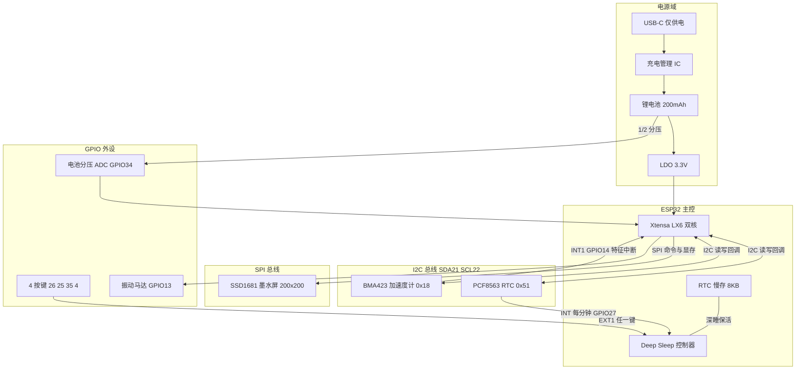

# Watchy 源码详解 00：总览与硬件架构

> 涉及文件：
> - `src/config.h`（引脚与硬件常量，全工程接线图）
> - `src/Watchy.h` / `src/Watchy.cpp`（主类：把所有硬件串成"手表"）
> - `src/WatchyRTC.h/.cpp`、`src/Watchy32KRTC.h/.cpp`（RTC 双实现）
> - `src/bma.h/.cpp`（BMA423 加速度计封装，底层 `bma4*.c/h` 为 Bosch 官方驱动）
> - `src/Display.h/.cpp`（200x200 墨水屏驱动，SSD1681 控制器）
> - `library.properties`（库依赖：GxEPD2 / WiFiManager / NTPClient / DS3232RTC / Rtc_Pcf8563 / Arduino_JSON）

---

## 1. Watchy 是什么：一个"库形态"的开源手表固件

Watchy 是 SQFMI 出的全开源墨水屏手表。它最特别的地方是**固件即 Arduino 库**：

- `src/` 是库本体：`Watchy` 基类实现了唤醒、深睡、菜单、对时、传感器全部脏活；
- `examples/WatchFaces/` 是表盘样例：**继承 `Watchy`、重写 `drawWatchFace()`** 就得到一个新表盘；
- 用户烧录时选一块"Watchy"板型（v1.0/v1.5/v2.0/v3.0），`config.h` 里的宏自动切换引脚表。

最小表盘（`examples/WatchFaces/Basic/Basic.ino`，共 10 行）：

```cpp
#include <Watchy.h>
#include "settings.h"

Watchy watchy(settings);

void setup(){
  watchy.init();
}

void loop(){}
```

注意 `loop()` 是**空的**——真正的循环发生在 `init()` 内部的"深睡↔唤醒"循环里（见
[01-库框架与生命周期](01-库框架与生命周期.md)）。

## 2. src/ 文件全景表

| 文件 | 行数* | 级别 | 职责 | 精读文章 |
|---|---|---|---|---|
| `Watchy.cpp` | 1168 | A | 主类实现：init/深睡/按键/菜单/天气/NTP/BMA 配置 | 01/03/04/05 |
| `Watchy.h` | 129 | A | 主类声明 + weatherData/watchySettings 结构体 | 01 |
| `WatchyRTC.cpp/.h` | 157+41 | A | DS3231/PCF8563 双芯片 RTC 抽象 | 02 |
| `bma.cpp/.h` | 288+91 | A | BMA423 加速度计封装（计步/翻腕/双击） | 03 |
| `Display.cpp/.h` | 510+103 | B | SSD1681 墨水屏寄存器驱动（GxEPD2 魔改） | 01 |
| `Watchy32KRTC.cpp/.h` | 102+22 | B | V3 专用：ESP32-S3 内部 RTC 实现 | 02 |
| `BLE.cpp/.h` | 135+44 | B | BLE OTA 固件升级服务端（默认停用） | 05 |
| `config.h` | 124 | B | 引脚表/板级宏/菜单与状态常量 | 本文 |
| `bma4.c/bma423.c/bma4*.h` | ~25000 | C | Bosch Sensortec 官方驱动（第三方，不注释） | 03 概述 |
| `DSEG7_Classic_Bold_53.h` | ~2000 | C | DSEG7 七段数码管字体数据（生成代码） | — |

\* 行数为注释添加前的原始行数；`file` 检查确认全部为 UTF-8/ASCII，无编码跳过。

## 3. 硬件拓扑：一块手表上有哪几颗芯片

Watchy v2.0（最常见代际）的关键元器件与连接关系：

| 部件 | 型号 | 总线/引脚 | 角色 |
|---|---|---|---|
| 主控 | ESP32 (WROOM-32) | — | 运行固件，深睡时整机待机 |
| 显示 | GDEH0154D67（SSD1681 控制器） | SPI @20MHz（CS=5, DC=10, RST=9, BUSY=19） | 200x200 黑白电子纸 |
| RTC | PCF8563 | I2C 0x51，INT→GPIO27 | 每分钟闹钟唤醒（ext0） |
| RTC（v1.0） | DS3231 | I2C 0x68，INT→GPIO27 | 同上，带温度传感器 |
| 加速度计 | BMA423 | I2C 0x18，INT1→GPIO14，INT2→GPIO12 | 计步/翻腕/双击特征引擎 |
| 按键 | 4×轻触开关 | GPIO26/25/35/4（Menu/Back/Up/Down） | 深睡唤醒（ext1） |
| 振动马达 | 扁平 LRA | GPIO13 经驱动管 | 整点提醒 |
| 电池 | 200mAh 锂聚 | 分压 1/2 → ADC GPIO34 | 电量监测 |
| USB | — | — | 仅充电（数据口未接 UART） |

I2C 总线（SDA=21, SCL=22）上挂着 RTC 与加速度计两颗从机；SPI 专供屏幕。
这个拓扑决定了软件分层：**I2C 层（RTC+BMA）走"探测+回调"，SPI 层（EPD）走命令时序**。



### 3.1 四个代际的关键差异

| | v1.0 | v1.5 | v2.0 | v3.0 |
|---|---|---|---|---|
| 主控 | ESP32 | ESP32 | ESP32 | **ESP32-S3** |
| RTC | DS3231 (0x68) | PCF8563 (0x51) | PCF8563 (0x51) | **无独立 RTC**（内部 RTC + 32K 晶振） |
| Up 键 GPIO | 32 | 32 | 35 | 0 |
| 电池 ADC GPIO | 33 | 35 | 34 | 9（分压比 1.278） |
| 按键有效电平 | 高 | 高 | 高 | **低** |
| 每分钟唤醒源 | RTC ext0 | RTC ext0 | RTC ext0 | 内部 timer |
| USB 检测 | 无 | 无 | 无 | 有（GPIO21） |

运行期不用看编译宏也能分辨代际：`Watchy::getBoardRevision()`（Watchy.cpp:941）
用 I2C 探测 + GPIO 电平自动识别，About 页直接显示结果。

## 4. 每分钟一次的"心跳"全链路

整只表的心跳是 **PCF8563 的每分钟闹钟**。从"芯片拉低 INT"到"屏上出现新的一分钟"：

```mermaid
flowchart LR
    A["PCF8563 闹钟比较"] -->|"INT 拉低 GPIO27"| B["ESP32 深睡唤醒 ext0"]
    B --> C["init 读取唤醒原因"]
    C --> D["RTC.read 取时间"]
    D --> E["guiState 分支"]
    E -->|"表盘态"| F["showWatchFace 部分刷新"]
    F --> G["用户 drawWatchFace 画帧"]
    G --> H["GxEPD2 写显存 SPI"]
    H --> I["0x22 0xFC 0x20 触发刷新"]
    I -->|"BUSY 约 500ms"| J["display.hibernate"]
    J --> K["clearAlarm 预约下一分钟"]
    K --> L["esp_deep_sleep_start"]
    L -->|"60s 后"| A
```



时序量化（Display.h:55-58 的实测常量）：

| 阶段 | 耗时 | 说明 |
|---|---|---|
| 屏幕升压上电 | ~100 ms | `asyncPowerOn()` 已与绘制重叠 |
| 部分刷新（每分钟 tick） | ~500 ms | `_Update_Part`，命令 0x22/0xFC/0x20 |
| 全刷（冷启动/进菜单） | ~2600 ms | `_Update_Full`，同时清残影 |
| 深睡期 | 60 s | 只有 RTC/BMA/按键监听，μA 级 |

**占空比估算**：部分刷模式下每 60.5 s 清醒 1 次约 0.5~1 s，清醒占空比 ~1%；
这就是 200mAh 电池能跑 1~2 周的根本原因（详细功耗账见
[05-Wi-Fi与低功耗实测指南](05-Wi-Fi与低功耗实测指南.md)）。

## 5. config.h：唯一的接线图

所有引脚差异都折叠在 `config.h` 里。板级宏树：

```
ARDUINO_ESP32S3_DEV（v3）
 ├─ SDA=12  SCL=11  屏 SPI 33/34/35/36
 ├─ 按键 7/6/0/8（低有效）  马达 17  电池 ADC 9
 └─ RTC_INT_PIN = -1（不用外置 RTC 中断）
ARDUINO_WATCHY_V10 / V15 / V20（v1/v1.5/v2）
 ├─ 按键 26/25/32或35/4（高有效）  马达 13
 ├─ 屏 SPI 5/9/10/19
 └─ RTC_INT_PIN = 27（PCF8563/DS3231 闹钟中断）
```

菜单与界面常量也在这个文件：

| 宏 | 值 | 用途 |
|---|---|---|
| `WATCHFACE_STATE` | -1 | guiState：表盘 |
| `MAIN_MENU_STATE` | 0 | guiState：主菜单 |
| `APP_STATE` | 1 | guiState：App 页面 |
| `FW_UPDATE_STATE` | 2 | guiState：固件更新（已停用） |
| `MENU_HEIGHT` | 25 | 每个菜单项像素高 |
| `MENU_LENGTH` | 6 | 菜单项数（Update FW 被注释掉） |
| `WIFI_AP_TIMEOUT` | 60 | 配网热点超时秒数 |
| `WIFI_AP_SSID` | "Watchy AP" | 配网热点名 |

按键掩码（ext1 唤醒位图）从引脚号生成：`MENU_BTN_MASK = BIT64(26)` 等，
`BTN_PIN_MASK` 是四键按位或——`deepSleep()` 用它注册 ext1 唤醒源，
`handleButtonPress()` 用 `esp_sleep_get_ext1_wakeup_status()` 反查是哪颗键。

## 6. 库依赖与角色

`library.properties` 声明的 7 个依赖各自只干一件事：

| 依赖 | 在 Watchy 里的用途 |
|---|---|
| GxEPD2 | 墨水屏驱动基类（Display.cpp 是它的特化魔改） |
| Adafruit GFX | 绘图 API（字体/图形原语） |
| WiFiManager | AP 配网门户（setupWifi） |
| NTPClient | UDP 对时（syncNTP） |
| DS3232RTC | v1.0 的 DS3231 驱动 |
| Rtc_Pcf8563 | v1.5/v2.0 的 PCF8563 驱动 |
| Arduino_JSON | 天气 JSON 解析 |

## 7. 读码路径建议

1. 先跑通一块表（或模拟器），建立"每分钟醒一次"的直觉；
2. 读本文第 4 节链路 → 进入 [01-库框架与生命周期](01-库框架与生命周期.md)
   看 `init()` 如何分派唤醒原因；
3. 想懂时间：[02-RTC与时间系统](02-RTC与时间系统.md)；
4. 想懂计步与"抬腕亮屏"为什么默认不唤醒：[03-BMA400与中断唤醒](03-BMA400与中断唤醒.md)；
5. 想改按键/菜单：[04-菜单与按键状态机](04-菜单与按键状态机.md)；
6. 想上 Wi-Fi/算续航：[05-Wi-Fi与低功耗实测指南](05-Wi-Fi与低功耗实测指南.md)。

KB 逐文件精读条目见 [Knowledge-Base/watchy/](../../../05-学习笔记与知识库/Knowledge-Base/watchy/)。

## 8. 陷阱速查（硬件层）

- **v1.5 与 v2.0 的 GPIO35 语义不同**：前者是电池 ADC，后者是按键 3——固件用
  `getBoardRevision()` 区分，自定义代码里不要硬编码引脚。
- **V3 按键低有效**：ext1 唤醒配置用 `ESP_EXT1_WAKEUP_ANY_LOW`，与 V1/V2 相反；
  `ACTIVE_LOW` 宏（Watchy.cpp:32/35）吸收了这个差异。
- **RTC_INT_PIN 在 V3 是 -1**：不能对 -1 调 `esp_sleep_enable_ext0_wakeup`，
  V3 代码路径已改用内部 timer（`deepSleep()` 的 `#ifdef` 分支）。
- **墨水屏 3.3V 供电且数据线也是 3.3V**（Display.h 头部英文注释强调）：
  5V 直插会烧屏。
- **深睡不影响屏幕显示**（电子纸双稳态），但**全刷/部分刷混用不当会积累残影**
  ——固件的策略是"进菜单/冷启动全刷、每分钟 tick 部分刷"。
