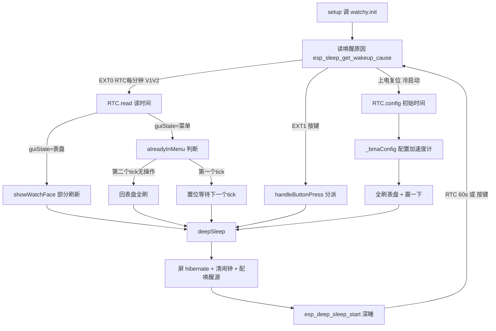
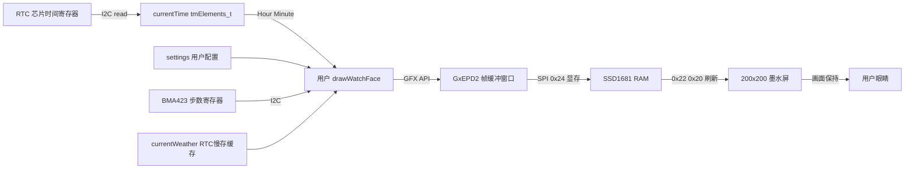
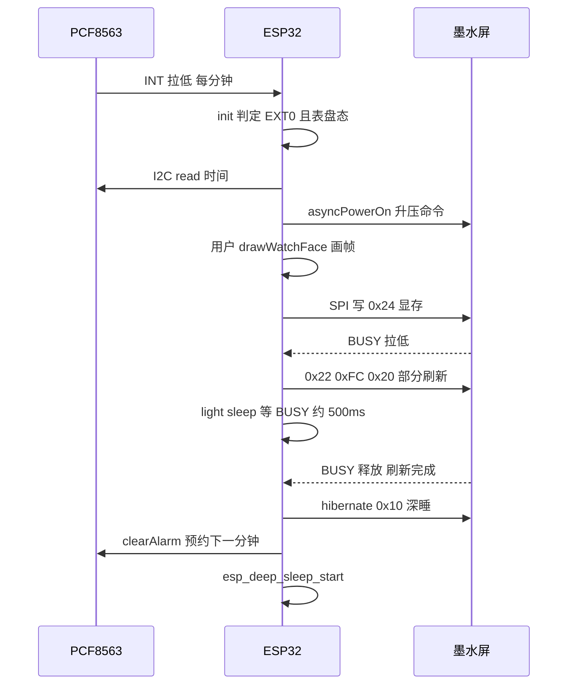

# Watchy 源码详解 01：库框架与生命周期

> 涉及文件：
> - `src/Watchy.h`（主类声明、weatherData/watchySettings、RTC 慢存全局声明）
> - `src/Watchy.cpp`（init/deepSleep/showWatchFace/drawWatchFace 等）
> - `src/Display.cpp`（busyCallback 的 light sleep、displayFullInit）
> - `examples/WatchFaces/Basic/Basic.ino`（最小宿主）

---

## 1. 设计模式："固件做成库"，用户只写表盘

Watchy 把固件反过来写：**脏活全在基类，用户继承后只 override 两个虚函数**。

| 虚函数 | 默认行为 | 用户覆写后 |
|---|---|---|
| `drawWatchFace()` | 画纯 DSEG7 大字号 HH:MM | 画任意表盘 |
| `handleButtonPress()` | 官方四键菜单逻辑 | 整盘接管按键语义 |

类结构（Watchy.h:94 起）：

| 成员 | 类型 | 说明 |
|---|---|---|
| `RTC` | `static WatchyRTC`（v3 为 `Watchy32KRTC`） | 全工程唯一 RTC 句柄 |
| `display` | `static GxEPD2_BW<WatchyDisplay,200>` | 全工程唯一屏幕句柄 |
| `currentTime` | `tmElements_t` | 最近一次 `RTC.read()` 的时间 |
| `settings` | `watchySettings` | 构造时传入的用户配置（天气/NTP/震动） |

用户表盘的样子（7_SEG 样例的核心，examples/WatchFaces/7_SEG/Watchy_7_SEG.cpp:11）：

```cpp
void Watchy7SEG::drawWatchFace(){
    display.fillScreen(DARKMODE ? GxEPD_BLACK : GxEPD_WHITE);
    display.setTextColor(DARKMODE ? GxEPD_WHITE : GxEPD_BLACK);
    drawTime();
    drawDate();
    drawSteps();
    drawWeather();
    drawBattery();
    ...
}
```

注意它**不需要调用 `display.display()`**——外壳 `showWatchFace()` 统一送显
（Watchy.cpp:796）：

```cpp
void Watchy::showWatchFace(bool partialRefresh) {
  display.setFullWindow();
  // At this point it is sure we are going to update
  display.epd2.asyncPowerOn();          // 异步升压：与用户绘制重叠 ~100ms
  drawWatchFace();                      // 虚函数 → 用户表盘
  display.display(partialRefresh);      // 统一送显
  guiState = WATCHFACE_STATE;
}
```

## 2. 生命周期总图：没有 loop() 的主循环

Arduino 宿主只调一次 `watchy.init()`。此后**每次唤醒都重新进入 init()**，
处理完立即深睡——"主循环"由硬件唤醒机制驱动：



三个醒来的原因对应 `init()` 的三个分支（Watchy.cpp:83-144，注释后行号）：

| 唤醒原因 | 分支 | 做什么 | 耗时量级 |
|---|---|---|---|
| `ESP_SLEEP_WAKEUP_EXT0`（V1/V2）/`TIMER`（V3） | RTC tick | 刷表盘或菜单超时回表盘 | 0.5~3 s |
| `ESP_SLEEP_WAKEUP_EXT1` | 按键 | `handleButtonPress()` | 与交互等长 |
| `default`（上电/复位） | 冷启动 | RTC/BMA/屏幕全初始化 | ~3 s |
| `ESP_SLEEP_WAKEUP_EXT0`（仅 V3） | USB 插拔 | 读 USB_DET，表盘态则刷新 | ~0.5 s |

冷启动分支只跑一次的关键调用（Watchy.cpp:127-143）：

```cpp
  default: // reset
    /* 冷启动（上电/按复位/烧录后）：唯一做全量外设初始化的路径——
       RTC 校时、BMA423 配置都只在这里跑一次，之后深睡唤醒不再重复 */
    RTC.config(datetime);
    _bmaConfig();
    ...
    gmtOffset = settings.gmtOffset;
    RTC.read(currentTime);
    RTC.read(bootTime);
    showWatchFace(false); // full update on reset
    vibMotor(75, 4);
```

## 3. 跨深睡的状态：RTC 慢存全局变量

普通全局变量深睡即丢；`RTC_DATA_ATTR` 把变量放进 ESP32 内部 8KB RTC 慢存，
**深睡保持、唤醒不清零**。Watchy 的"状态机跨越睡眠"全靠这一组变量
（Watchy.cpp:46-58）：

| 变量 | 类型 | 作用 | 谁写谁读 |
|---|---|---|---|
| `guiState` | int | 界面状态机 -1/0/1/2 | 各 show* 写，init 读 |
| `menuIndex` | int | 菜单选中项 0~5 | 按键处理写，showMenu 读 |
| `sensor` | BMA423 | 传感器封装对象（含 I2C 回调指针） | _bmaConfig 初始化 |
| `currentWeather` | weatherData | 天气缓存 | _getWeatherData |
| `weatherIntervalCounter` | int | 天气节流计数（-1=从未拉取） | _getWeatherData |
| `gmtOffset` | long | 天气 API 学到的时区偏移 | syncNTP/showSyncNTP |
| `alreadyInMenu` | bool | 菜单 60s 无操作超时标志 | init/showMenu |
| `bootTime` | tmElements_t | 冷启动时刻（About 页算 uptime） | 冷启动写 |
| `lastIPAddress`/`lastSSID` | uint32_t/char[30] | About 页显示连接信息 | connectWiFi/setupWifi 写 |

**初始化只在冷启动生效**：RTC 慢存变量即使写了 `= -1` 这样的初值，
深睡唤醒后也不会重新赋值（数据手册语义：上电复位才初始化）。所以
`weatherIntervalCounter` 能跨睡眠记住"上次拉天气是几分钟前"。

## 4. deepSleep()：所有路径的汇合点

Watchy.cpp:155 起。执行四步：

1. `display.hibernate()` —— 向 SSD1681 发 0x10/0x01 深睡命令（Display.cpp:356）；
2. `RTC.clearAlarm()` —— 清闹钟标志并预约下一分钟（否则醒来立即又触发）；
3. 配置唤醒源（V1/V2 与 V3 路径不同）：
   - V1/V2：ext0 = RTC INT（GPIO27，低电平）；ext1 = `BTN_PIN_MASK`（任一高电平）；
     外加把除 `ignore` 掩码外的全部 GPIO 切输入防漏电（Watchy.cpp:180-185）；
   - V3：ext0 = USB 检测、ext1 = 按键（低电平）、内部 timer 定到下一整分
     （`rtc_clk_32k_enable(true)` 启用外部 32K 晶振做睡眠时钟源）；
4. `esp_deep_sleep_start()` —— 不再返回，唤醒后从 `init()` 开头重新执行。

值得注意的细节（Watchy.cpp:169-174）：

```cpp
  rtc_clk_32k_enable(true);
  struct tm timeinfo;
  getLocalTime(&timeinfo);
  int secToNextMin = 60 - timeinfo.tm_sec;
  esp_sleep_enable_timer_wakeup(secToNextMin * uS_TO_S_FACTOR);
```

V3 用"当前秒数取补"的办法对齐整分钟唤醒，与 V1/V2 的 RTC 分匹配闹钟殊途同归。

## 5. 屏幕侧的低功耗配合

墨水屏本身双稳态（不供电保持画面），驱动层还有三处配合：

| 机制 | 位置 | 效果 |
|---|---|---|
| `busyCallback` light sleep | Display.cpp:47 | 屏幕 BUSY 期间（刷新 0.5~2.6s）CPU 进 light sleep 等待而非忙等 |
| `asyncPowerOn` | Display.cpp:69 | 升压 100ms 与绘制重叠，每帧省 ~100ms |
| `reduceBoosterTime` | Display.cpp:452-461 | 压缩 booster 相位时序，全刷再省 ~200ms |
| `displayFullInit`（RTC 慢存） | Display.cpp:45 | 跨深睡记住"是否已做过首次全刷" |

## 6. 一帧表盘的数据流



数据载体清单：时间=tmElements_t（8 字节日历结构）；步数=uint32_t；
天气=weatherData（含 String，注意 RTC 慢存里的 String 跨深睡有效性依赖堆未重启）；
显存=200×200/8=5000 字节/帧。

## 7. 一次 tick 的时序（sequenceDiagram）



## 8. 陷阱与读码要点

- **`loop()` 为空是设计而非偷懒**：如果在 loop() 里写代码，它只会在
  `init()` 返回后运行——但 `init()` 只在深睡后才返回（实际上 `esp_deep_sleep_start`
  不返回，所以 loop() **永远执行不到**，除非用户覆写 init 流程）。
- **RTC 慢存里的 `sensor` 对象**：BMA423 对象跨深睡存活的前提是它的成员
  （I2C 回调函数指针）指向的静态函数地址不变——这正是 `_readRegister/_writeRegister`
  声明为 static 的深层原因（Watchy.cpp:976/995）。
- **`alreadyInMenu` 初值 true**（Watchy.cpp:54）：冷启动第一次进菜单后，
  一个 tick 就会被"弹回"表盘——这是故意的（冷启动即已是"在菜单"语义）。
- **`guiState` 不在表盘态时每分钟不刷表盘**：菜单/App 页面里 RTC tick 被
  用来做"60 秒无操作"超时，所以表停了时间也不会错——回表盘时重新 `RTC.read`。
- **`showWatchFace` 里没有 `RTC.read`**：时间由调用方读好（init 的 tick 分支
  Watchy.cpp:89），用户 drawWatchFace 直接用 `currentTime`。
- KB 精读：[watchy_cpp.md](../../../05-学习笔记与知识库/Knowledge-Base/watchy/watchy_cpp.md)、
  [watchy_h.md](../../../05-学习笔记与知识库/Knowledge-Base/watchy/watchy_h.md)。
