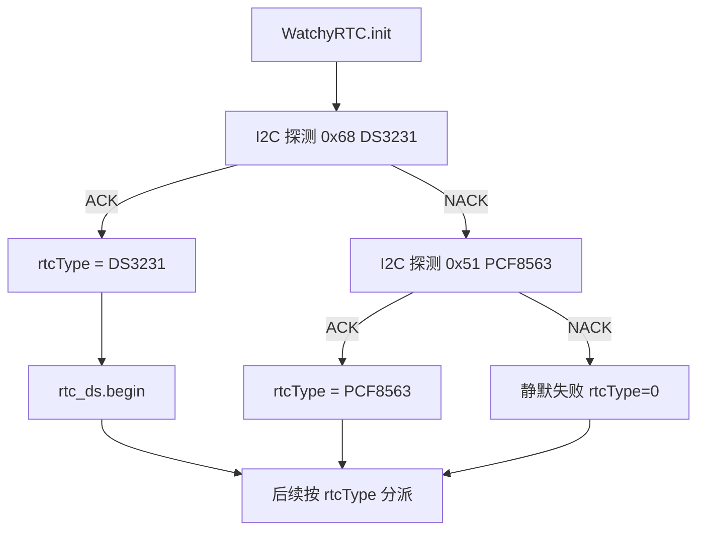
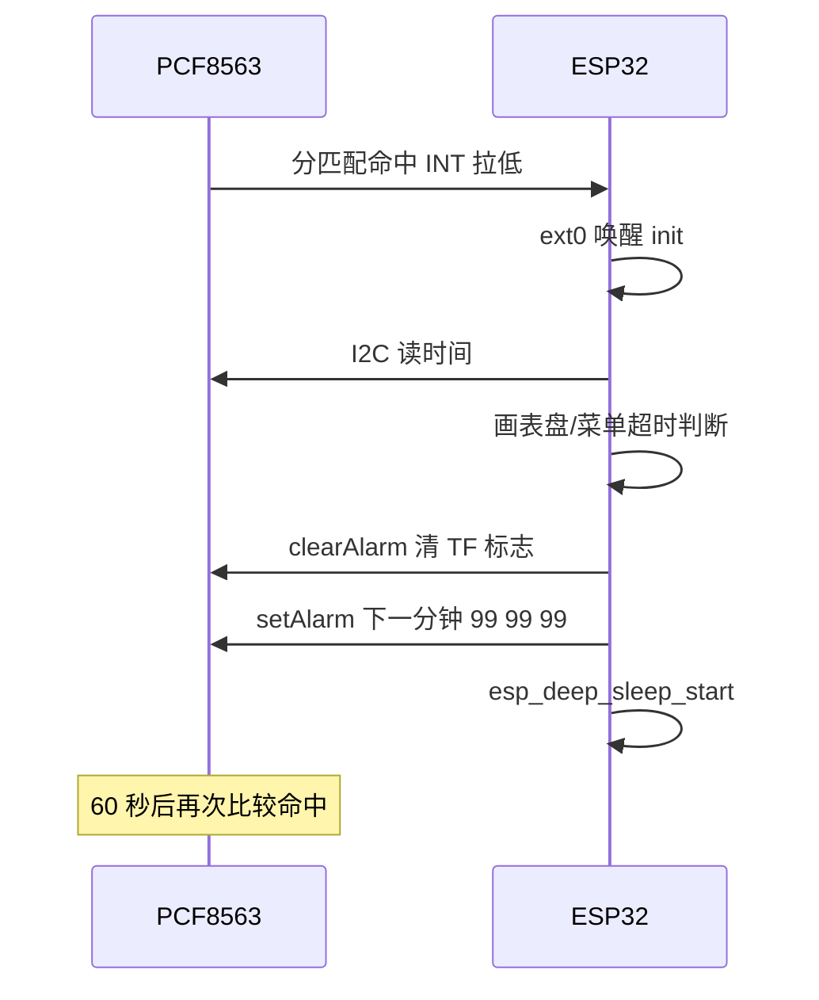
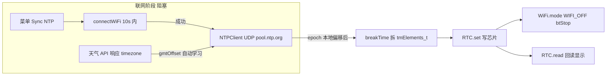

# Watchy 源码详解 02：RTC 与时间系统

> 涉及文件：
> - `src/WatchyRTC.h/.cpp`（DS3231/PCF8563 双芯片抽象，本文主角）
> - `src/Watchy32KRTC.h/.cpp`（v3.0 的内部 RTC 等价实现）
> - `src/Watchy.cpp` 的 `syncNTP()`（Watchy.cpp:1366-1401）与 `showSyncNTP()`（Watchy.cpp:1315）
> - 第三方：`DS3232RTC` 库、`Rtc_Pcf8563` 库、`NTPClient` 库

---

## 1. 时间系统全景：谁在计时、谁在唤醒

Watchy 有两套"时间"概念，初学者最容易混：

| 概念 | 载体 | 精度 | 用途 |
|---|---|---|---|
| 日历时间 | 外置 RTC 芯片（DS3231/PCF8563）或 V3 内部 RTC | 1 s | 表盘显示、闹钟 |
| 唤醒心跳 | RTC 芯片的每分钟闹钟（或 V3 timer） | 1 min | 深睡唤醒源 |

**为什么用外置 RTC 而不是 ESP32 自己计时？** 深睡时 ESP32 主电源域断电
（RTC 慢存只有 8KB 且计时器不够准/不保日历），而 PCF8563 靠纽扣电池域
独立走时，整个深睡期间时间不丢、还能定时唤醒——它是深睡世界里唯一的钟。

三颗/三种 RTC 的对照：

| | DS3231（v1.0） | PCF8563（v1.5/v2.0） | 内部 RTC（v3.0） |
|---|---|---|---|
| I2C 地址 | 0x68 | 0x51 | —（系统调用） |
| 年份基准 | time_t 1970 基 | BCD 00-99（2000 基） | tm_year 1900 基 |
| 星期寄存器 | 1-7 | 0-6 | 0-6 |
| 温度传感器 | 有（±3℃） | 无 | 无 |
| 每分钟唤醒 | ALARM_2 每分钟模式 | 闹钟只比分钟字段 | `esp_sleep_enable_timer_wakeup` |
| 驱动库 | DS3232RTC | Rtc_Pcf8563 | ESP-IDF newlib |

## 2. 芯片探测：init() 的 ACK 摸底

WatchyRTC.cpp:18。用 I2C `endTransmission()` 的返回值当"门铃"——有 ACK 即在线：

```cpp
void WatchyRTC::init() {
  byte error;
  Wire.beginTransmission(RTC_DS_ADDR);
  error = Wire.endTransmission();
  if (error == 0) {
    rtcType = DS3231;
    rtc_ds.begin();
  } else {
    Wire.beginTransmission(RTC_PCF_ADDR);
    error = Wire.endTransmission();
    if (error == 0) {
      rtcType = PCF8563;
    } else {
      // RTC Error
    }
  }
}
```

要点：
- 一块板只焊一颗 RTC，探测顺序 0x68 → 0x51；
- **两颗都没 ACK 时静默失败**：`rtcType` 保持 0，之后所有 `if (rtcType == DS3231)`
  都走 else 分支（按 PCF8563 操作）——硬件排查时先看这里；
- `init()` 每次唤醒都跑（Watchy::init 里），代价仅 1~2 次 I2C 地址探测。



## 3. 每分钟闹钟：clearAlarm() 的"清标志 + 预约下一分钟"

WatchyRTC.cpp:58。这个函数在**每次深睡前**被 `Watchy::deepSleep()` 调用，
是"心跳持续跳动"的关键：

```cpp
void WatchyRTC::clearAlarm() {
  if (rtcType == DS3231) {
    rtc_ds.alarm(DS3232RTC::ALARM_2);
  } else {
    /* PCF8563：clearAlarm 复位标志后，把闹钟设到下一分钟（59 分则绕回 0 点） */
    int nextAlarmMinute = 0;
    rtc_pcf.clearAlarm(); // resets the alarm flag in the RTC
    nextAlarmMinute = rtc_pcf.getMinute();
    nextAlarmMinute =
        (nextAlarmMinute == 59)
            ? 0
            : (nextAlarmMinute + 1); // set alarm to trigger 1 minute from now
    rtc_pcf.setAlarm(nextAlarmMinute, 99, 99, 99);
  }
}
```

逐行解释 PCF8563 分支：
- `rtc_pcf.clearAlarm()`：读 TF 标志并清零。**不清的话 INT 电平保持有效，
  ext0 唤醒条件持续成立，醒来立刻又睡又醒死循环**；
- `getMinute()` 取当前分钟 → +1 = 下一分钟；59 分则绕回 0；
- `setAlarm(min, 99, 99, 99)`：PCF8563 的闹钟是"字段使能"式——99 是
  "该字段不比较"的哨兵，等效于"只匹配分钟"的每分钟闹钟。

DS3231 分支只需一句 `rtc_ds.alarm(ALARM_2)`：DS3232RTC 库的 `alarm()` 读状态
即清标志，而闹钟本身在 `_DSConfig` 里已配成 `ALM2_EVERY_MINUTE`（永久每分钟），
无需重复预约。



## 4. read/set：两个时间域的翻译官

读（WatchyRTC.cpp:82）：

```cpp
void WatchyRTC::read(tmElements_t &tm) {
  if (rtcType == DS3231) {
    rtc_ds.read(tm);
  } else {
    rtc_pcf.getDate();
    tm.Year  = y2kYearToTm(rtc_pcf.getYear());
    tm.Month = rtc_pcf.getMonth();
    tm.Day   = rtc_pcf.getDay();
    tm.Wday =
        rtc_pcf.getWeekday() + 1; // TimeLib & DS3231 has Wday range of 1-7, but
                                  // PCF8563 stores day of week in 0-6 range
    tm.Hour   = rtc_pcf.getHour();
    tm.Minute = rtc_pcf.getMinute();
    tm.Second = rtc_pcf.getSecond();
  }
}
```

- `y2kYearToTm()`：把 2000 基年份换算成 TimeLib 的"自 1970"域（减 30）；
- `Wday + 1`：TimeLib 约定周日=1..周六=7，PCF8563 寄存器 0-6；
- PCF8563 驱动的 getter 每个都是一次独立 I2C 读，共 7 次事务——若要优化可
  一次 burst 读 7 个寄存器（未做，属可改进点而非 bug）。

写（WatchyRTC.cpp:105）：

```cpp
void WatchyRTC::set(tmElements_t tm) {
  if (rtcType == DS3231) {
    time_t t = makeTime(tm);
    rtc_ds.set(t);
  } else {
    time_t t = makeTime(tm); // make and break to calculate tm.Wday
    breakTime(t, tm);
    // day, weekday, month, century(1=1900, 0=2000), year(0-99)
    rtc_pcf.setDate(
        tm.Day, tm.Wday - 1, tm.Month, 0,
        tmYearToY2k(tm.Year)); // TimeLib & DS3231 has Wday range of 1-7, but
                               // PCF8563 stores day of week in 0-6 range
    // hr, min, sec
    rtc_pcf.setTime(tm.Hour, tm.Minute, tm.Second);
    clearAlarm();
  }
}
```

亮点是 `makeTime` → `breakTime` 的"往返"：调用方给的 tmElements_t 往往
**没有填 Wday**（如 NTP 对时只拆出了日期时间），TimeLib 在 `makeTime` 时
按日历推算星期，`breakTime` 再拆回日历结构时 Wday 已经算好了——借库算星期。
`setDate` 的第 4 参 century 传 0 表示 2000 系。写完顺手 `clearAlarm()` 重约
下一次闹钟（写寄存器过程可能扰动标志）。

## 5. NTP 对时链路

用户菜单触发 `showSyncNTP()`（Watchy.cpp:1315）→ `connectWiFi()` → `syncNTP()`；
天气流程也会"顺路"对时（用天气 API 的 timezone 字段当偏移）。

对时实现（Watchy.cpp:1388）：

```cpp
bool Watchy::syncNTP(long gmt, String ntpServer) {
  // NTP sync - call after connecting to
  // WiFi and remember to turn it back off
  WiFiUDP ntpUDP;
  NTPClient timeClient(ntpUDP, ntpServer.c_str(), gmt);
  timeClient.begin();
  if (!timeClient.forceUpdate()) {
    return false; // NTP sync failed
  }
  tmElements_t tm;
  breakTime((time_t)timeClient.getEpochTime(), tm);
  RTC.set(tm);
  return true;
}
```

- `NTPClient` 的构造第三参就是 UTC 偏移（秒），`getEpochTime()` 返回
  **已加偏移的本地 epoch**；
- `breakTime` 把 epoch 拆成日历字段 → `RTC.set()` 写芯片——**RTC 里存的是
  本地时间**（不是 UTC），读出来直接显示，没有运行期时区换算；
- 失败返回 false：UDP 两次重试均无响应（NTPClient 内部逻辑）。



时区偏移的优先级：天气 API 学到的 `gmtOffset`（RTC 慢存）> 用户 settings.h
的 `GMT_OFFSET_SEC`（仅冷启动时 `gmtOffset = settings.gmtOffset` 一次）。

## 6. 日历渲染的三个换算

表盘显示时间时的三个"域差"（渲染侧用 TimeLib 宏还原）：

| 域 | 存储值 | 显示还原 | 宏 |
|---|---|---|---|
| 年 | `tm.Year` = 自 1970 | 2025 | `tmYearToCalendar(tm.Year)` |
| 星期 | `tm.Wday` 1-7 | "Sunday"... | `dayStr(tm.Wday)` |
| 月 | 1-12 | "Jan"... | `monthShortStr(tm.Month)` |

样例（examples/WatchFaces/7_SEG/Watchy_7_SEG.cpp:56-76）：

```cpp
    String dayOfWeek = dayStr(currentTime.Wday);
    ...
    display.println(tmYearToCalendar(currentTime.Year));// offset from 1970, since year is stored in uint8_t
```

字符串解析（`_getValue`，WatchyRTC.cpp:201）：按 `:` 单趟切分取第 index 段，
O(n)，用于把 `"YYYY:MM:DD:HH:MM:SS"` 拆进 tmElements_t（冷启动初始时间）。
`CalendarYrToTm` 在解析时把 2025 换算成 55（1970 基）。

## 7. V3 的 Watchy32KRTC：借系统时钟冒充 RTC

Watchy32KRTC.cpp 用 ESP-IDF 的 `settimeofday()/localtime_r()` 实现 同名五接口。
对照要点：

| 函数 | Watchy32KRTC 实现 | 注意 |
|---|---|---|
| `config(datetime)` | `strptime` 解析 → `mktime` → `settimeofday` | TZ 未设置时 mktime 按 UTC 解释 |
| `read(tm)` | `time()` + `localtime_r()`，`tm_year-70` 换算 | 依赖系统时区设置 |
| `set(tm)` | `mktime` → `settimeofday` | 同上 |
| `clearAlarm()` | **空实现** | 唤醒由 `esp_sleep_enable_timer_wakeup` 负责 |
| `temperature()` | 恒 0 | 无传感 |

年代换算陷阱：`tm_year` 是"自 1900"、`tmElements_t.Year` 是"自 1970"，
所以 `read()` 里 `tm.Year = timeInfo.tm_year - 70`，`set()` 里反向 `+70`
（Watchy32KRTC.cpp:56-73）。V3 若要本地时间正确，需自己 `setenv("TZ",...)`——
源码里保留了被注释掉的 `setenv("TZ", "CST-8", 1)` 示例（Watchy32KRTC.cpp:60-62 附近）。

## 8. 陷阱速查

- **PCF8563 POR 后月份寄存器为 0**（合法域 1-12）：`_PCFConfig` 无论如何调
  `clearAlarm()` 把状态拉回合法（WatchyRTC.cpp:169，注释有说明）。
- **`_getDayOfWeek()` 是死声明**：WatchyRTC.h 声明了却从未定义/调用
  （WatchyRTC.h:54），读码时不要找它的实现。
- **clearAlarm 忘调 = 唤醒风暴**：INT 标志不清，ext0 电平一直有效。
- **NTP 时机**：`syncNTP` 必须在 `connectWiFi()` 成功后调，否则 UDP 静默超时。
- **RTC 存本地时间**：换时区/夏令时要重新对时（或靠天气 API 的 timezone 字段）。
- **DS3231 的 `temperature()` 返回 int8 域整度数**，只能当环境粗测。
- KB 精读：[watchyrtc_cpp.md](../../../05-学习笔记与知识库/Knowledge-Base/watchy/watchyrtc_cpp.md)、
  [watchyrtc_h.md](../../../05-学习笔记与知识库/Knowledge-Base/watchy/watchyrtc_h.md)、
  [watchy32krtc_cpp.md](../../../05-学习笔记与知识库/Knowledge-Base/watchy/watchy32krtc_cpp.md)。
