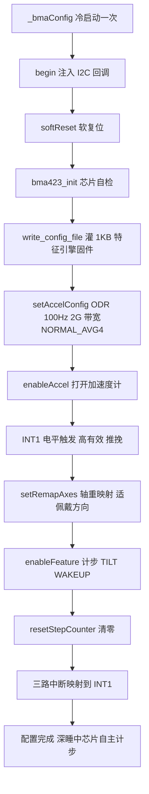
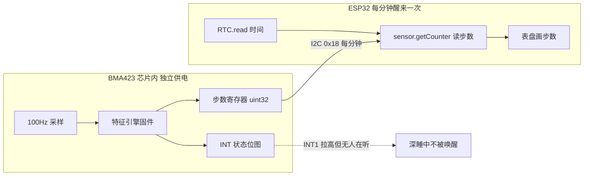
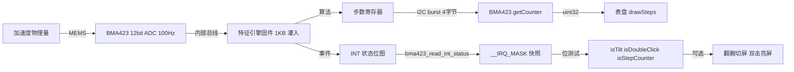

# Watchy 源码详解 03：BMA400 与中断唤醒

> 涉及文件：
> - `src/Watchy.cpp` 的 `_bmaConfig()`（Watchy.cpp:1012-1113）与 `_readRegister/_writeRegister`（Watchy.cpp:976/995）
> - `src/bma.h/.cpp`（BMA423 封装层，本文逐函数入口）
> - `src/bma4.c`、`src/bma423.c`、`src/bma4_defs.h`、`src/bma4.h/bma423.h`（Bosch 官方驱动，第三方）
> - `src/config.h`（`ACC_INT_1_PIN 14`、`ACC_INT_MASK`）

> 说明：任务书所称"BMA400"在 Watchy 里实为 **BMA423**（Bosch BMA400 后继、
> 带特征引擎的版本），共享同一 BMA4xx 驱动框架（`bma4.c`）。

---

## 1. 三层驱动结构

| 层 | 文件 | 角色 |
|---|---|---|
| 芯片通用层 | `bma4.c/h`（Bosch） | 寄存器读写、I2C 分片、电源控制，与具体型号无关 |
| 型号特性层 | `bma423.c/h`（Bosch） | 特征引擎：计步/翻腕/抬腕唤醒/活动分类的固件加载与控制 |
| Watchy 封装层 | `bma.cpp/h` | 注入 I2C 回调、包装常用 API、维护 IRQ 状态位图 |
| 使用方 | `Watchy::_bmaConfig()` + 表盘 | 冷启动配置一次，醒来读结果 |

BMA423 的关键特性：**特征引擎跑在传感器芯片内部**。ESP32 深睡断主电时，
BMA423 仍在供电、仍以 100Hz 采样、仍独立累计步数——这是"深睡计步"成立的前提。

## 2. I2C 回调注入：static 函数 + RTC 慢存对象

Bosch 驱动不认识 Wire 库，要求宿主注入三个函数指针（读/写/延时）。
Watchy 的做法（Watchy.cpp:1014）：

```cpp
  if (sensor.begin(_readRegister, _writeRegister, delay) == false) {
    // fail to init BMA
    return;
  }
```

两个 I2C 回调是 `Watchy` 的 **static 私有成员**（Watchy.cpp:976/995）：

```cpp
uint16_t Watchy::_readRegister(uint8_t address, uint8_t reg, uint8_t *data,
                               uint16_t len) {
  Wire.beginTransmission(address);
  Wire.write(reg);
  Wire.endTransmission();
  Wire.requestFrom((uint8_t)address, (uint8_t)len);
  uint8_t i = 0;
  while (Wire.available()) {
    data[i++] = Wire.read();
  }
  return 0;
}
```

为什么必须 static：`sensor` 对象放在 RTC 慢存（`RTC_DATA_ATTR BMA423 sensor`），
深睡唤醒后它的成员指针必须仍然有效——指向静态函数地址恒定；若指向成员函数
（带 this），this 指针的合法性在睡眠前后无法保证。

## 3. _bmaConfig()：一次配齐六个环节

Watchy.cpp:1012-1113，只在冷启动分支执行。流程图：



参数选择的量化理由：

| 配置 | 取值 | 为什么 |
|---|---|---|
| ODR | 100 Hz（Watchy.cpp:1037） | Bosch 计步算法推荐采样率；再高只费电 |
| 量程 | 2G（Watchy.cpp:1045） | 步行冲击 <2G；1LSB≈0.98mg 分辨率最高 |
| 带宽 | NORMAL_AVG4（Watchy.cpp:1057） | 每样本 4 次过采样，抗手抖 |
| 性能模式 | CONTINUOUS（Watchy.cpp:1064） | 特征引擎需要连续数据流 |
| INT1 | 电平/高有效/推挽（Watchy.cpp:1076-1080） | 与 ESP32 ext 唤醒电平语义对齐 |
| 轴重映射 | X↔Y 对调且符号翻转（Watchy.cpp:1087-1092） | 芯片贴装方向 → 表壳坐标系 |

特征与中断的分工（容易混的一对概念）：

| 调用 | 作用对象 | 效果 |
|---|---|---|
| `enableFeature(BMA423_STEP_CNTR,1)` | 芯片内部算法 | 开始计步并置状态位 |
| `enableStepCountInterrupt()` | INT1 引脚映射 | 算法产出中断时把 INT1 拉高 |

## 4. 中断→唤醒链路的真相（重要）

**Stock 固件里 BMA423 的中断并不唤醒 ESP32。** 证据在 `deepSleep()`
（Watchy.cpp:186-190）：

```cpp
  esp_sleep_enable_ext0_wakeup((gpio_num_t)RTC_INT_PIN,
                               0); // enable deep sleep wake on RTC interrupt
  esp_sleep_enable_ext1_wakeup(
      BTN_PIN_MASK,
      ESP_EXT1_WAKEUP_ANY_HIGH); // enable deep sleep wake on button press
```

唤醒源只有两个：RTC 闹钟（ext0）与四个按键（ext1）。`ACC_INT_MASK`
（config.h）虽定义了，但从未被注册进唤醒源——BMA 的 INT1（GPIO14）在
深睡期间"拉高了也没人听"。

于是 stock 固件的计步模型是**轮询式**：



7_SEG 表盘就是每分钟读一次步数（examples/WatchFaces/7_SEG/Watchy_7_SEG.cpp:78-87）：

```cpp
void Watchy7SEG::drawSteps(){
    // reset step counter at midnight
    if (currentTime.Hour == 0 && currentTime.Minute == 0){
      sensor.resetStepCounter();
    }
    uint32_t stepCount = sensor.getCounter();
    ...
}
```

**想真正实现"抬腕/双击唤醒"**，需要在自定义表盘的 `handleButtonPress`/init
或直接改 deepSleep 配置：把 GPIO14 加入 ext 唤醒，例如
`esp_sleep_enable_ext0_wakeup((gpio_num_t)ACC_INT_1_PIN, 1)`（高电平唤醒，
与 INT1 的"高有效电平"配置匹配），唤醒后用 `sensor.getINT()` 区分是哪路中断。

## 5. 中断消费模型：getINT + is*()

清醒状态下（菜单/自定义页面）BMA 中断的标准用法（bma.cpp:293）：

```cpp
bool BMA423::getINT() {
  return bma423_read_int_status(&__IRQ_MASK, &__devFptr) == BMA4_OK;
}
```

- 一次 I2C 读把芯片 INT 状态寄存器快照进 `__IRQ_MASK`，**读后芯片自动清零**
  ——同一中断只能消费一次；
- 之后 `isStepCounter()/isTilt()/isDoubleClick()` 全是对 `__IRQ_MASK` 的位测试，
  不再产生 I2C 访问（bma.cpp:332-347）；
- `enableFeature` 里对 STEP_CNTR 有一个特判：要先开 `step_detector` 再开
  计步（bma.cpp:322-330）。

## 6. 计步数据流全链路（数据流图）



## 7. 备用能力：温度与朝向

- `readTemperature()`（bma.cpp:188）：BMA423 内置温度传感器，驱动返回
  `(原始值-23)/512` 的定点数（1/512 ℃/LSB）；寄存器 0x80 表示无效，
  换算结果恰为 0——**无网天气的退化数据源**（Watchy.cpp:899 直接用）。
- `getDirection()`（bma.cpp:150）：三轴绝对值取最大轴定方向，按符号分
  6 朝向（枚举 DIRECTION_*，bma.h）；Show Accelerometer 页面实时演示
  （Watchy.cpp:716 起，200ms 刷新节流）。

## 8. 陷阱与实测建议

- **`begin()` 幂等**：`__init` 已置位时直接返回 true（bma.cpp:41-44），重复
  begin 不会重配芯片；深睡唤醒路径**本来也不该**重配（配置在 RTC 慢存对象里）。
- **计步读失败与 0 步不可区分**：`getCounter()` I2C 失败也返回 0（bma.cpp:274-279），
  表盘可能把故障画成 0 步。
- **`resetStepCounter()` 时机**：只在 0 点整自动清零（表盘自行判断）；自定义
  页面手动清零会连带清掉表盘显示的当日步数——两处共享一个寄存器。
- **INT 状态读后即清**：`getINT()` 之后未处理的位不能"下次再处理"。
- **深睡中 INT1 拉高无副作用但也无功能**：想省掉这条线的中断电流可
  `disableIRQ(BMA423_TILT_INT)` 等，或反过来自己注册 ext0 唤醒实现抬腕亮屏。
- **0x80=无效温度**：退化天气显示 0℃ 的假象已内建于固件（容忍性 bug，
  记录不改，见 KB bma_cpp.md）。
- KB 精读：[bma_cpp.md](../../../05-学习笔记与知识库/Knowledge-Base/watchy/bma_cpp.md)、
  [bma_h.md](../../../05-学习笔记与知识库/Knowledge-Base/watchy/bma_h.md)。
