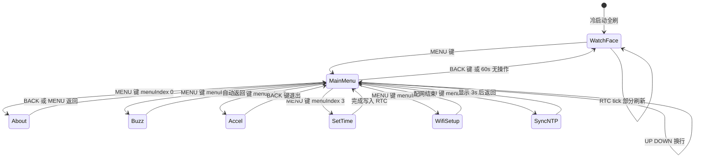
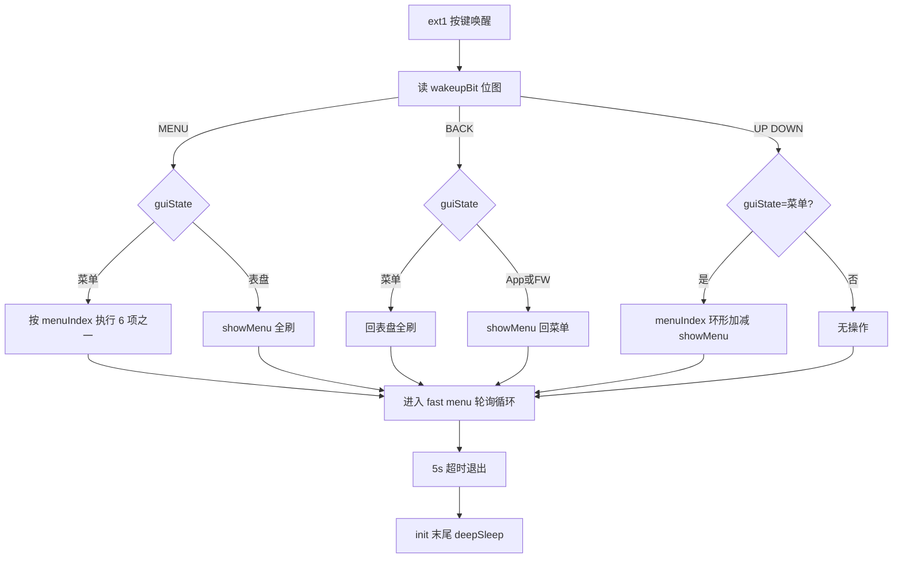
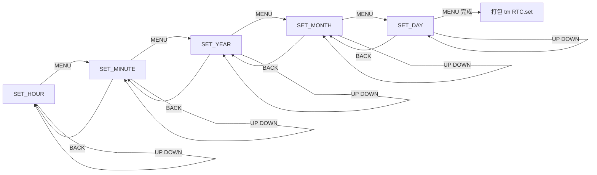
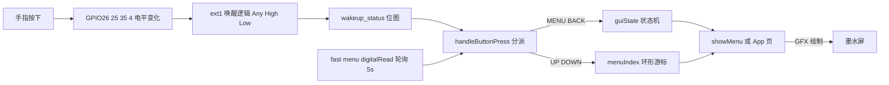

# Watchy 源码详解 04：菜单与按键状态机

> 涉及文件：
> - `src/Watchy.cpp`：`handleButtonPress()`（Watchy.cpp:204-360）、`showMenu()`（Watchy.cpp:369）、`showFastMenu()`（Watchy.cpp:409）、`setTime()`（Watchy.cpp:539）
> - `src/Watchy.h`：`extern RTC_DATA_ATTR int guiState/menuIndex`（Watchy.h:166-167）
> - `src/config.h`：状态宏与按键引脚/掩码（`WATCHFACE_STATE -1`、`MENU_LENGTH 6` 等）

---

## 1. 状态集：guiState 只有 4 个值

| 状态 | 宏 | 值 | 含义 | 进入者 |
|---|---|---|---|---|
| 表盘 | `WATCHFACE_STATE` | -1 | 正常显示时间 | showWatchFace |
| 主菜单 | `MAIN_MENU_STATE` | 0 | 6 项菜单高亮列表 | showMenu/showFastMenu |
| App 页 | `APP_STATE` | 1 | About/Buzz/加速计/对时/WiFi | 各 show* 页面 |
| 固件更新 | `FW_UPDATE_STATE` | 2 | BLE OTA（已停用） | showUpdateFW（注释掉） |

菜单的 6 项（Watchy.cpp:378-381）：About Watchy / Vibrate Motor /
Show Accelerometer / Set Time / Setup WiFi / Sync NTP（Update Firmware 被注释）。
选中项序号在 `menuIndex`（RTC 慢存，**跨唤醒记住上次停在哪一项**）。

## 2. 状态机全图（stateDiagram-v2）



注意所有 App 页面的"返回"路径最终都汇回 `showMenu()`；主菜单的退出
（BACK 或 60s 无操作）回到表盘——整个 UI 是无栈的两层结构，**没有子菜单**。

## 3. 按键 × 状态动作矩阵

四个键在每种状态下的行为（源自 handleButtonPress 的两段实现）：

| 按键 | 表盘态 | 主菜单态 | App 页态 |
|---|---|---|---|
| MENU（右上） | 进菜单 | 执行选中项 | 页面自定义（对时=下一字段） |
| BACK（右下） | 无操作 | 回表盘 | 回菜单 |
| UP（左上） | 无操作 | menuIndex-1（环形） | 页面自定义（对时=加） |
| DOWN（左下） | 无操作 | menuIndex+1（环形） | 页面自定义（对时=减） |

环形滚动（Watchy.cpp:258-263）：

```cpp
    if (guiState == MAIN_MENU_STATE) { // increment menu index
      menuIndex--;
      if (menuIndex < 0) {
        menuIndex = MENU_LENGTH - 1;
      }
      showMenu(menuIndex, true);
    }
```

## 4. handleButtonPress：一次按键唤醒的生命

按键是深睡唤醒源（ext1），所以"按键事件"的物理起点是唤醒本身。
`esp_sleep_get_ext1_wakeup_status()` 返回 64 位位图，哪一位为 1 = 哪颗键
把系统叫醒（Watchy.cpp:204-208）：

```cpp
void Watchy::handleButtonPress() {
  uint64_t wakeupBit = esp_sleep_get_ext1_wakeup_status();
  /* 位图哪一位为 1 = 哪颗键把系统唤醒（deepSleep() 里 ext1 注册的 BTN_PIN_MASK） */
  // Menu Button
  if (wakeupBit & MENU_BTN_MASK) {
    if (guiState ==
        WATCHFACE_STATE) { // enter menu state if coming from watch face
      showMenu(menuIndex, false);
```

执行流（第一段，唤醒分派）：



## 5. 快菜单：清醒轮询的 5 秒窗口

第一段分派完，函数**不返回深睡**，而是进入一个忙等轮询循环
（Watchy.cpp:281-291）：

```cpp
  /***************** fast menu *****************/
  /* 快菜单：保持清醒、忙等轮询电平（不进深睡），实现连续滚动；
     5 秒（5000ms）无按键即超时跳出，返回后 init() 末尾统一深睡。
     注意 UP/DOWN 在这里走 showFastMenu()（部分刷新，滚得快）。 */
  bool timeout     = false;
  long lastTimeout = millis();
  pinMode(MENU_BTN_PIN, INPUT);
  pinMode(BACK_BTN_PIN, INPUT);
  pinMode(UP_BTN_PIN, INPUT);
  pinMode(DOWN_BTN_PIN, INPUT);
  while (!timeout) {
    if (millis() - lastTimeout > 5000) {
      timeout = true;
    } else {
```

设计对比（这是理解 Watchy 交互的钥匙）：

| | 第一段（唤醒分派） | 第二段（快菜单循环） |
|---|---|---|
| 事件来源 | ext1 硬件唤醒位图 | `digitalRead` 电平轮询 |
| 事件次数 | 一次（唤醒它的那颗键） | 5 秒内任意次 |
| 刷新方式 | `showMenu`（partialRefresh 可选） | `showFastMenu`（恒部分刷 ~0.5s） |
| 结束方式 | 落入第二段 | 超时/BACK 回表盘 break |
| 功耗 | — | 清醒满负荷 ~100mA，最多 5 秒 |

每次轮询到按键都会 `lastTimeout = millis()` 续命——连续滚动时不会中途睡着。
BACK 在菜单态回表盘后 `break` 直接跳出循环（Watchy.cpp:333）。

两段按键逻辑是**复制粘贴关系**（6 个菜单项的 switch 出现两次），改菜单必须
同步两处，这是本文件最大的维护陷阱（源码注释亦已标注）。

## 6. 60 秒无操作回表盘：alreadyInMenu

菜单态下若用户停手，下一次 RTC tick（60 秒后）在 `init()` 里被拦截
（Watchy.cpp:101-111）：

```cpp
    case MAIN_MENU_STATE:
      // Return to watchface if in menu for more than one tick
      /* alreadyInMenu 是"菜单停留计时器"：第一个 tick 置 true，第二个 tick
         仍无人操作就回表盘——用 RTC 闹钟当 60 秒无操作超时器，不占任何定时器资源 */
      if (alreadyInMenu) {
        guiState = WATCHFACE_STATE;
        showWatchFace(false);
      } else {
        alreadyInMenu = true;
      }
      break;
```

- `showMenu()` 末尾把 `alreadyInMenu = false`（Watchy.cpp:401）重新计时；
- 快菜单循环里连续滚动会一直清醒，tick 不会发生（深睡才有时钟 tick）；
- 妙处：**用已有的每分钟闹钟当了 UI 超时定时器**，零额外资源。

## 7. setTime：字段游标子状态机

Set Time 页面（Watchy.cpp:539-708）是嵌在 APP_STATE 里的第二个状态机：
游标 `setIndex` 在 5 个字段间移动，当前字段闪烁。

| setIndex | 宏 | UP/DOWN 步进范围 |
|---|---|---|
| 0 | SET_HOUR | 0-23 |
| 1 | SET_MINUTE | 0-59 |
| 2 | SET_YEAR | 0-99（显示 2000+year） |
| 3 | SET_MONTH | 1-12 |
| 4 | SET_DAY | 1-31 |



"闪烁"实现：每轮 while 取反 `blink`，选中字段的 `setTextColor` 在黑白间切换
（Watchy.cpp:639-641），配合部分刷新 ~0.5s/帧形成闪动感。年字段域差提示：
V1/V2 用 `tmYearToY2k`（2000 基）换算，V3 直接用（Watchy.cpp:545-557）。

## 8. 按键事件的数据流（flowchart LR）



## 9. 陷阱速查

- **改菜单要改三处**：`showMenu` 与 `showFastMenu` 里的 `menuItems[]` +
  `handleButtonPress` 两段 switch（共 2 份）——4 个复制粘贴点。
- **UP 在 Watchy 上是 menuIndex--**（左上键向上滚）与直觉一致但源码里
  两个方向的名字反着写（注释里 increment/decrement 是相对菜单列表而言）。
- **按键无去抖**：ext1 是电平唤醒，快菜单轮询也无消抖；墨水屏刷新慢
  （~0.5s/帧）天然限制了抖动影响，但金属弹片老化后可能一次按下多次触发。
- **`menuIndex` 跨唤醒保留**：RTC 慢存语义，回表盘再进菜单还在原位置
  ——有人当 bug，其实是有用的记忆。
- **FW_UPDATE_STATE(2) 与 case 5 的 updateFW 全部被注释停用**：BLE OTA
  通道保留在 BLE.cpp 但不可达（见 05 的 BLE 一节）。
- KB 精读：[watchy_cpp.md](../../../05-学习笔记与知识库/Knowledge-Base/watchy/watchy_cpp.md)、
  [config_h.md](../../../05-学习笔记与知识库/Knowledge-Base/watchy/config_h.md)。
