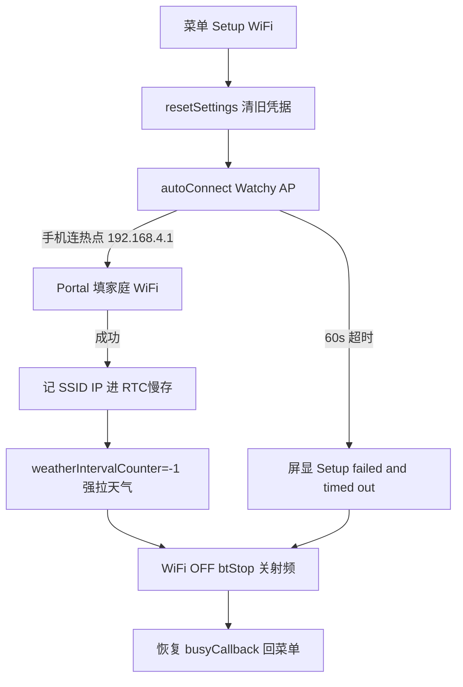
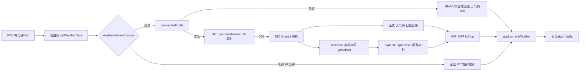

# Watchy 源码详解 05：Wi-Fi 与低功耗实测指南

> 涉及文件：
> - `src/Watchy.cpp`：`setupWifi()`（Watchy.cpp:1123）、`connectWiFi()`（Watchy.cpp:1182）、`_getWeatherData()`（Watchy.cpp:846）、`showSyncNTP()`（Watchy.cpp:1315）、`syncNTP()` 三重载（Watchy.cpp:1366-1401）、`deepSleep()`（Watchy.cpp:155）
> - `src/Display.cpp`：`busyCallback()`（Display.cpp:47，屏幕 BUSY 期 light sleep）
> - `src/config.h`：`WIFI_AP_TIMEOUT 60`、`WIFI_AP_SSID "Watchy AP"`
> - `src/BLE.cpp`（BLE OTA，默认停用）

---

## 1. 联网的三个入口

| 入口 | 触发 | 用途 | 阻塞时长 |
|---|---|---|---|
| `setupWifi()` | 菜单 Setup WiFi | WiFiManager AP 配网（改凭据） | ≤60s（热点超时） |
| `connectWiFi()` | 天气/NTP 自动 | 用 NVS 存的凭据直连 | ~10s |
| `showSyncNTP()` | 菜单 Sync NTP | 手动对时 | 10s+3s 读屏 |



关键代码（Watchy.cpp:1123 起）：

```cpp
void Watchy::setupWifi() {
  display.epd2.setBusyCallback(0); // temporarily disable lightsleep on busy
  WiFiManager wifiManager;
  wifiManager.resetSettings();
  wifiManager.setTimeout(WIFI_AP_TIMEOUT);
  wifiManager.setAPCallback(_configModeCallback);
```

`setBusyCallback(0)` 的用意：配网期间需要高频重绘 + 网络事件，
屏幕 BUSY 时的 light sleep（Display.cpp:47）会拖慢网络逻辑，临时关掉；
结束时恢复 `WatchyDisplay::busyCallback`（Watchy.cpp 末段）。

`connectWiFi()`（Watchy.cpp:1182）是自动联网的统一入口：

```cpp
bool Watchy::connectWiFi() {
  if (WL_CONNECT_FAILED ==
      WiFi.begin()) { // WiFi not setup, you can also use hard coded credentials
                      // with WiFi.begin(SSID,PASS);
    WIFI_CONFIGURED = false;
  } else {
    if (WL_CONNECTED ==
        WiFi.waitForConnectResult()) { // attempt to connect for 10s
      lastIPAddress = WiFi.localIP();
      WiFi.SSID().toCharArray(lastSSID, 30);
      WIFI_CONFIGURED = true;
    } else { // connection failed, time out
      WIFI_CONFIGURED = false;
      // turn off radios
      WiFi.mode(WIFI_OFF);
      btStop();
    }
  }
  return WIFI_CONFIGURED;
}
```

注意：`WiFi.begin()` 无参 = 用 NVS 凭据；失败路径**先关射频再返回**——
成功路径的关射频由调用方（`_getWeatherData`）负责。

## 2. 天气 + NTP 联合数据流

天气是 Watchy 唯一的"重量级联网任务"，它把天气、时区学习、NTP 对时
三件事合并成一次联网（省电设计）：



节流的实现（Watchy.cpp:849-853）：

```cpp
  currentWeather.isMetric = units == String("metric");
  /* 计数器 -1 表示"还没联网过"（setupWifi 成功后也会重置为 -1 强拉一次） */
  if (weatherIntervalCounter < 0) { //-1 on first run, set to updateInterval
    weatherIntervalCounter = updateInterval;
  }
```

`weatherIntervalCounter` 在 RTC 慢存里**跨深睡计数**：每次表盘刷新调一次
`getWeatherData()`（每分钟），计数没到 30 就 +1 直接返回缓存。所以
"30 分钟天气" = 30 次唤醒才联网 1 次，功耗上把 WiFi 摊薄到可忽略。

无网退化路径（Watchy.cpp:896-905）：BMA423 内置温度当"天气"、
天气码固定 800（晴）、`external=false`——表盘可据此画"离线"样式。

## 3. NTP 对时实操（不带电脑）

1. 菜单 → **Setup WiFi** → 屏幕显示热点信息；
2. 手机连 **Watchy AP** 热点（密码无），浏览器开 `192.168.4.1`；
3. Portal 里选家庭 WiFi、输密码、保存；手表屏显示 SSID/IP；
4. 菜单 → **Sync NTP**：屏显 `Syncing NTP... GMT offset: <秒>`；
5. 成功后显示 `NTP Sync Success` 与新时间；失败检查路由器是否放行
   UDP 123 出站。

时区说明：首次对时用 settings.h 的 `GMT_OFFSET_SEC`（样例是纽约 -5h，
**记得改成 3600*8**）；之后天气 API 的 timezone 会自动覆盖（跨时区旅行
先拉一次天气即可校准）。

## 4. 深睡功耗预算：谁在睡、谁没睡

`deepSleep()`（Watchy.cpp:155-193）执行后的整机状态：

| 部件 | 状态 | 功耗量级 |
|---|---|---|
| ESP32 主电源域 | 断电（深睡） | ~10-150 μA（含 RTC 慢存 + ext 监听） |
| 墨水屏 | hibernate 0x10，画面保持 | ~0（双稳态，无维持电流） |
| PCF8563 | 正常走时 + 闹钟 | ~0.25 μA |
| BMA423 | 特征引擎连续模式 | ~14-30 μA（ODR 100Hz + 计步） |
| 电池分压电阻 | 常通（V1/V2 分压 1/2 直接到地） | 数 μA 级漏电（硬件固有） |

唤醒源一览（V1/V2）：

| 源 | 引脚/机制 | 触发条件 |
|---|---|---|
| ext0 | GPIO27（RTC INT） | 低电平（每分钟闹钟） |
| ext1 | GPIO26/25/35/4 位图 | 任一按键高电平 |
| （无） | GPIO14 BMA INT1 | **未注册**——抬腕不唤醒（见 Docs/03） |

清醒期功耗（供估算）：部分刷新 ~20-40mA×0.5s；全刷峰值更高×2.6s；
WiFi 联网窗口 ~100mA×（3~13s）/30min；快菜单轮询 ~100mA×最长 5s。

## 5. 电池寿命估算（给计算过程）

以 200mAh 电池、纯表盘模式（7_SEG，含天气）为例：

```
每次一分钟 tick 的清醒耗电：
  部分刷新     0.5 s × 30 mA  = 15 mAs
  I2C/CPU 杂项 0.3 s × 40 mA  = 12 mAs
  合计每 tick ≈ 27 mAs ≈ 7.5 μAh

每次天气（30 分钟一次摊到每分钟）：
  连接+HTTP+对时 ~6 s × 100 mA = 600 mAs / 30 = 20 mAs/tick ≈ 5.6 μAh

每分钟平均耗电 ≈ 7.5 + 5.6 ≈ 13 μAh
深睡基流（ESP32+PCF8563+BMA423+分压）≈ 60 μA × 1/60 h ≈ 1.0 μAh

总平均电流 ≈ (13 μAh / (1/60)h) + 60 μA ≈ 780 + 60 ≈ 840 μA
理论续航 ≈ 200 mAh / 0.84 mA ≈ 238 h ≈ 10 天
```

把天气间隔调成 120 分钟或关天气，可到 2 周以上；官方标称"最多 2 周"
对应无天气+部分刷场景。**全刷模式（每分钟全刷 2.6s）会把续航砍半**——
这就是为什么 tick 用 `showWatchFace(true)` 部分刷。

## 6. 实测建议（有表的情况下）

| 实验 | 方法 | 预期 |
|---|---|---|
| 深睡电流 | 串联万用表 μA 档，表盘静置 1 分钟读数 | 20~100 μA |
| tick 电流曲线 | 串 1Ω 电阻+示波器看每 60s 的电流脉冲 | ~0.5s 宽的 30mA 峰 |
| 天气窗口 | 设 30min 间隔，观察周期性 ~100mA 平台 | 每半小时一次 3-10s |
| 抬腕唤醒 DIY | `esp_sleep_enable_ext0_wakeup(ACC_INT_1_PIN,1)` 加进自定义 deepSleep | 翻腕亮屏 |
| WiFi 失联行为 | 拔路由器 WAN，观察 Sync NTP | ~10s 超时显示 Not Configured/Failed |

## 7. 坑点清单（源码实证）

1. **`WiFi.begin()` 无凭据时仍等 10s**：`waitForConnectResult()` 的等待在
   没配网时会白等——首次开机先 Setup WiFi，别直接 Sync NTP。
2. **忘记 `btStop()`**：经典 ESP32 蓝牙常开 = +30mA 级；Watchy 的四个联网
   路径都记得关，自定义代码容易漏。
3. **HTTP 不设超时**：`setConnectTimeout(3000)` 只管连接，`http.GET()` 靠
   WiFiClient 默认超时兜底；极慢服务器会拖长清醒窗口。
4. **`String` 进了 RTC 慢存**：`currentWeather.weatherDescription` 是 String
   （堆对象）。深睡期间堆不初始化（RTC 慢存语义），能活下来；但**冷启动后
   该内存随机**——代码靠 `weatherIntervalCounter < 0` 保证冷启动第一次
   就去联网填充，从而不会读垃圾 String（初始化为 -1 的初值只在冷启动生效）。
5. **v1.0 与 v1.5/v2.0 的 ADC 引脚不同**（GPIO33 vs GPIO35），分压同为 1/2；
   V3 是 GPIO9 + 1.278 分压。写自定义电量显示用 `getBatteryVoltage()`，别读裸 ADC。
6. **屏幕 BUSY 期 light sleep 与自定义中断冲突**：busyCallback 会让 CPU
   睡到 BUSY 释放（Display.cpp:47-51），期间 GPIO 中断仍可唤醒，但
   `millis()` 累积可能跳变——高精度定时别与刷新重叠。
7. **BLE OTA 不可达**：`updateFWBegin()` 整段注释（Watchy.cpp:1203-1308），
   BLE.cpp 的服务端代码是"死资产"，编译进固件但不被启动（BLE 类从未实例化
   于默认流程）。
8. **PCF8563 闹钟 59→0 回绕**：`clearAlarm` 已处理（WatchyRTC.cpp:66-69），
   自定义闹钟逻辑别忘这个边界。
9. **快菜单 5 秒硬上限**：连续滚动每 5s 内必须再按键，否则回深睡；
   想延长改 `> 5000`（Watchy.cpp:292）。
10. **天气 URL 是 http 不是 https**（settings.h 模板）：省 TLS 内存，但
    apikey 明文上网——自用可接受，发布固件别硬编码自己的 key。
- KB 精读：[ble_cpp.md](../../../05-学习笔记与知识库/Knowledge-Base/watchy/ble_cpp.md)、
  [display_cpp.md](../../../05-学习笔记与知识库/Knowledge-Base/watchy/display_cpp.md)。
